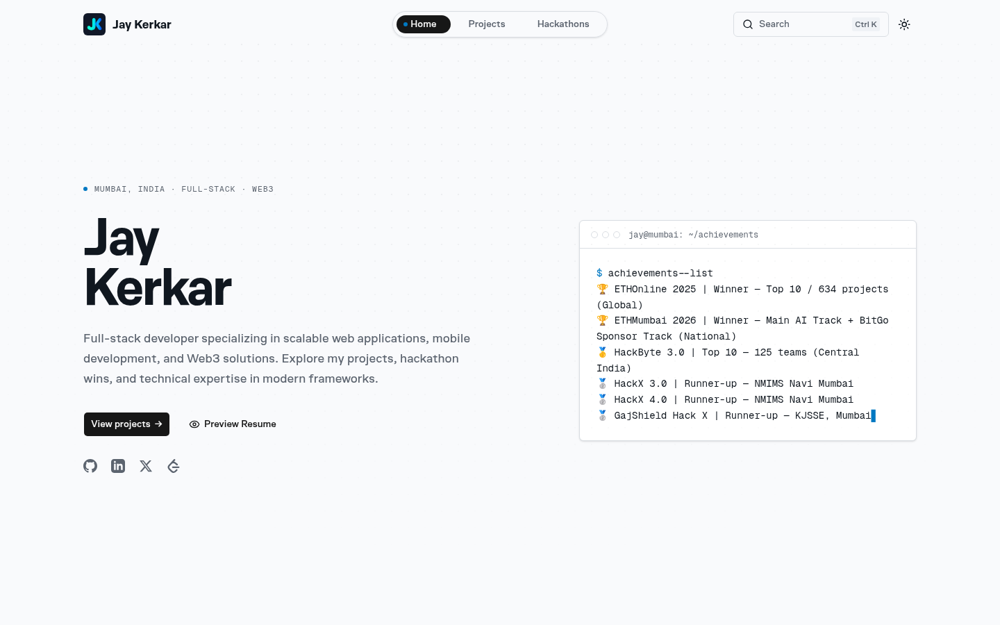
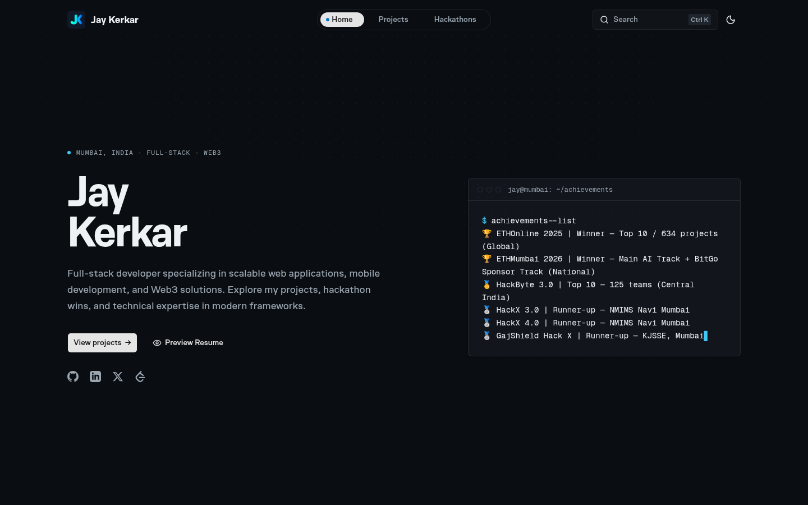

# Workbench

Jay Kerkar's portfolio: [jaykerkar.is-a.dev](https://jaykerkar.is-a.dev). It is built like an engineer's build log: mono labels, numbered indices, hairlines instead of cards, and one accent colour.

## Preview

| Light                                                                                                                    | Dark                                                                                                                   |
| ------------------------------------------------------------------------------------------------------------------------ | ---------------------------------------------------------------------------------------------------------------------- |
|  |  |

## Tech Stack

- [SvelteKit 2](https://kit.svelte.dev) - Application framework
- [Svelte 5](https://svelte.dev) - Component framework with runes syntax
- [Tailwind CSS v4](https://tailwindcss.com) - Utility-first CSS framework
- [shadcn/svelte](https://shadcn-svelte.com) - Re-usable component library
- [TypeScript](https://typescriptlang.org) - Type safety
- [mdsvex](https://mdsvex.com) - Markdown for Svelte
- [pnpm](https://pnpm.io) - Package manager

## Project Structure

```
src/
├── app.html               # HTML template (meta tags, fonts, no-JS handling)
├── lib/
│   ├── assets/            # Icons and project / hackathon images
│   ├── components/        # Site components (compose the primitives in ui/)
│   │   └── ui/            # shadcn/svelte primitives
│   ├── config/            # Navigation
│   ├── hackathons/        # Hackathon data and types
│   └── projects/          # Project data, types and .svx write-ups
└── routes/
    ├── +error.svelte      # Error page
    ├── +layout.svelte     # Header, footer, view transitions
    ├── +page.svelte       # Home
    ├── hackathons/        # Timeline and [id] detail pages
    ├── projects/          # Listing and [id] detail pages
    ├── sitemap.xml/       # Generated sitemap
    └── layout.css         # Design tokens, utilities and prose styles
```

## Design System

Everything visual is defined in [src/routes/layout.css](src/routes/layout.css), which Tailwind v4 reads directly.

- **Tokens:** tinted neutrals, the `--brand` accent (the cyan-blue of the JK logo, with `--brand-foreground`) and the motion tokens `--dur-1`, `--dur-2`, `--dur-3`, `--ease-out` and `--ease-in-out`. There is a light and a dark set.
- **Utilities:** `label` (mono uppercase caption), `text-display`, `text-page-title`, `dot-grid`, `link-underline` and `cursor-blink`.
- **Prose:** `.prose-log` styles the rendered `.svx` write-ups.
- **Primitives and composition:** UI primitives come from shadcn/svelte and live in `src/lib/components/ui/`. Site components in `src/lib/components/` compose them.

## Motion and Accessibility

- Elements below the fold fade in through a scroll-reveal attachment (`src/lib/components/reveal.ts`), and page navigation uses the View Transitions API, so shared icons and titles carry across pages.
- Under `prefers-reduced-motion: reduce` all of this is off: no reveals, count-ups, typing or transitions. The terminal shows its full text.
- Without JavaScript, text, icons and hackathon photos are visible, along with the terminal text and the final numbers. Project screenshots load on the client and show an empty frame until then.
- Focus rings use the full accent colour, and text contrast is checked against both themes.

## Getting Started

### Prerequisites

- Node.js 20.19 or later (or 22.12 or later), as required by Vite 8
- pnpm 9 or later (the lockfile is version 9)

### Installation

Install dependencies:

```bash
pnpm install
```

### Environment

Copy `.env.example` to `.env` and set:

| Variable          | Used for                                                                                                         |
| ----------------- | ---------------------------------------------------------------------------------------------------------------- |
| `GITHUB_PAT`      | A GitHub personal access token. The build uses it to fetch repository stars and team profiles.                   |
| `PUBLIC_SITE_URL` | The site's public URL, used for the sitemap, canonical URLs and social images (default `http://localhost:5173`). |

Both variables must be defined for the build. If the token is invalid, the build still succeeds and omits the repository stars and team avatars; team members then show as plain GitHub links.

### Development

Start the development server:

```bash
pnpm dev
```

The application will be available at `http://localhost:5173`.

### Build

Create a production build:

```bash
pnpm build
```

Preview the production build:

```bash
pnpm preview
```

`pnpm preview` runs the SvelteKit server handler, so it differs from a static host. To see how the built files behave on one, serve the `build` directory with any static file server.

## Scripts

| Script                 | Description                                     |
| ---------------------- | ----------------------------------------------- |
| `pnpm dev`             | Start development server                        |
| `pnpm build`           | Build for production                            |
| `pnpm preview`         | Preview production build                        |
| `pnpm format`          | Format code with Prettier                       |
| `pnpm lint`            | Lint code with ESLint and Prettier              |
| `pnpm check`           | Type-check with svelte-check                    |
| `pnpm check:watch`     | Type-check in watch mode                        |
| `pnpm optimize:images` | Optimise project and hackathon icons and images |

## Adding Components

Add shadcn/svelte components:

```bash
pnpm dlx shadcn-svelte@latest add <component>
```

## Configuration

### Tailwind CSS

Tailwind v4 is configured in CSS, in [src/routes/layout.css](src/routes/layout.css), and enabled through the Vite plugin in [vite.config.ts](vite.config.ts). There is no `tailwind.config.js`.

### SvelteKit

SvelteKit is configured in [svelte.config.js](svelte.config.js) with the static adapter for pre-rendering. The adapter also emits a `404.html` fallback; it renders the error page in the browser for addresses that were not pre-rendered, if the host serves it for unknown URLs.

### TypeScript

TypeScript configuration is in [tsconfig.json](tsconfig.json). Path aliases are configured for `$lib` and other imports.

## Deployment

This project uses `@sveltejs/adapter-static` for static site generation. The built files in the `build` directory can be deployed to any static hosting service.

## License

This project is licensed under the MIT License. See [LICENSE](LICENSE) for details.
